# Loan approval prediction

[](https://loan-approval-prediction.streamlit.app)

Educational loan-decision project by **Ladarius Jackson**. A scikit-learn pipeline scores a public Lending Club sample, compares logistic regression with histogram gradient boosting under cross-validation, and turns a stated dollar loss into an approve / decline cutoff. The Streamlit desk scores one application, explains a decline in plain English, simulates the holdout book at a cutoff you pick, and scores a CSV.

This is a teaching model on 9,578 historical loans. It does not issue a credit offer, a denial, or a compliance determination. The dollar figures below are a planning scenario. The file has no charge-off balance, so they are not a lender's profit and loss. The full card is [MODEL_CARD.md](MODEL_CARD.md).

## The business question

A consumer lender has to fund a loan or turn it away before anyone knows whether it will be repaid. Approving everyone books the loans that never fully repay. Declining everyone protects that loss and gives up the loans that would have paid. The useful question is whether a score, with a cutoff chosen only on the training book, beats both of those rules on loans it has not seen.

In this file, **fully paid** is the positive class. A predicted positive is an approval.

The planning weights, used only to pick the cutoff and to talk about money:

| Error | What happened | Planning cost |
| --- | --- | ---: |
| False approval | Fund a loan that is not fully paid | $5,000 |
| False decline | Turn away a loan that is fully paid | $600 |

Why these two numbers. The extract has no term and no loss amount. At the sample's mean interest rate (12.264%) and mean monthly installment ($319.09), a 36-month amortizing loan implies about $9,571 of principal and about $1,917 of gross interest. Five thousand dollars is a round weight near half of that principal sketch. Six hundred dollars is a round weight below that gross interest, standing in for net contribution after funding costs the file does not record. Change the weights and the cutoff moves. The desk keeps the score and the cutoff separate for that reason.

On a calibrated probability, those two weights break even at 5,000 / (5,000 + 600) = 0.893. The training grid picked **0.89**.

## Data

| | |
| --- | --- |
| Name | Lending Club loan sample, OpenML `Lending-Club-Loan-Data` |
| OpenML | [data id 43729](https://www.openml.org/d/43729) |
| Size | 9,578 loans, 13 predictors, no missing values in the cached file |
| Outcomes | 8,045 fully paid (84.0%), 1,533 not fully paid (16.0%) |
| How this project fetches it | `sklearn.datasets.fetch_openml(data_id=43729, as_frame=True)` |
| License | CC0: Public Domain, the licence field OpenML records for data id 43729 |
| What this file is | The entire OpenML extract. It is already a public sample, not the multi-million-row Lending Club servicing tape |

No account and no API key. The table used for training, tests, CI, and the app is cached at `data/lending_club_sample.csv`, so those all run offline. `PYTHONPATH=src python -m loan_approval.train --download` refreshes the cache from OpenML.

The target column in the file is `not_fully_paid` (1 = the borrower did not fully repay). The model scores the complementary event.

The deployed score does **not** see `credit_policy` (Lending Club's own underwriting flag) or `int_rate` (the price the platform assigned from its risk grade). Both already contain a lender's judgment. They stay in the cache for a side comparison. The extract has no sex, age, or race fields, so this project cannot run a protected-class audit.

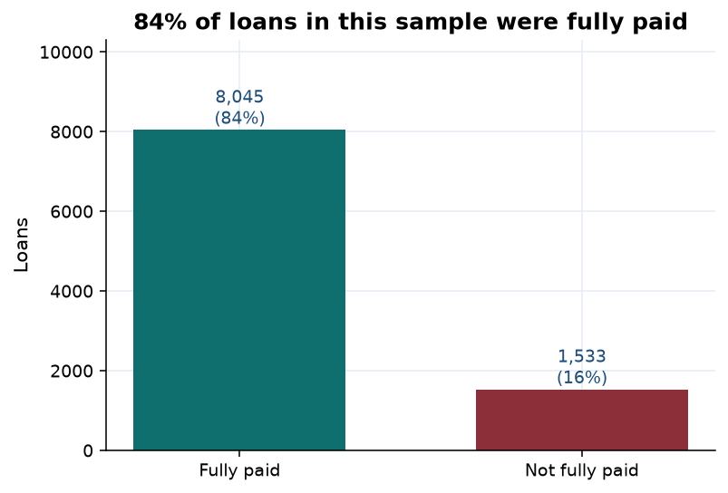

## Method

The holdout is a stratified 20% split (1,916 loans, seed 42). Model choice and the cutoff are fit on the other 7,662 loans only.

Preprocessing lives inside one `sklearn` pipeline, so each cross-validation fold refits it:

- numeric fields: median imputation, then `StandardScaler`
- loan purpose: most-frequent imputation, then one-hot encoding with `handle_unknown="ignore"`

Scaling gives the logistic penalty comparable units. A per-feature rescaling does not change tree splits, so histogram gradient boosting neither gains nor loses from sharing that step.

Two classifiers share the same shuffled `StratifiedKFold` (5 folds, seed 42):

- logistic regression (`lbfgs`, L2)
- histogram gradient boosting (`HistGradientBoostingClassifier`)

LightGBM is the same algorithm family and was left out. It would add a binary wheel to the Streamlit Community Cloud install without changing the comparison this project is set up to make.

Each model is scored once with library defaults, then with a randomized search (`n_iter=16`, or the full 12-cell logistic grid, which is smaller). The search metric is ROC-AUC. The provisional leader is the highest mean cross-validated ROC-AUC, then the smaller fold standard deviation, then the simpler model. A more complex leader is kept only when the paired bootstrap 95% interval for its out-of-fold ROC-AUC advantage excludes zero. The interval is a percentile bootstrap, 1,000 resamples, seed 42. The holdout bootstrap is reported and is not used to choose the model.

After the model is chosen, isotonic regression maps the score to a probability. Each out-of-fold score is transformed by a map that did not see that row. The saved map is refit on all out-of-fold scores and applied to the model refit on the 7,662 training loans. The cutoff minimizes average planning cost on those cross-fit probabilities. A tie takes the higher cutoff. The holdout is scored once.

A second refit, at the winning hyperparameters, puts `credit_policy` and `int_rate` back. A third refit drops FICO. Neither is allowed to pick the deployed model.

The desk explains one application by replacing each field with the training median or the most common purpose and recording the change in the ranking score, before the isotonic map. The map is flat in places, so a field can move the ranking and leave the calibrated probability unchanged. For a decline, the largest drops are written as plain-English reasons. A second pass scores one-field changes on the calibrated probability, inside the training range, and names a change that would clear the cutoff when one exists. Correlated fields share credit. Neither note is an adverse-action letter.

## Results

The deployed model is **logistic regression**. Mean cross-validated ROC-AUC is 0.670 ± 0.015. Histogram gradient boosting reaches 0.658 ± 0.012. The paired out-of-fold bootstrap 95% interval for logistic regression minus boosting is 0.003 to 0.021, which excludes zero, so the selection rule keeps logistic regression. Logistic regression is deployed. It led on cross-validated ROC-AUC, and the paired out-of-fold bootstrap 95% interval for its ROC-AUC advantage over Histogram gradient boosting excludes zero.

The same gap on the holdout is 0.006, with a 95% interval of -0.010 to 0.022, which includes zero. The holdout point estimates rank logistic regression first. They do not, by themselves, separate the two models. The holdout was not used to choose.

| Model | CV ROC-AUC, default | CV ROC-AUC, tuned | Holdout ROC-AUC, uncalibrated | Holdout 95% interval |
| --- | ---: | ---: | ---: | ---: |
| **Logistic regression** | 0.669 ± 0.017 | **0.670 ± 0.015** | **0.704** | 0.673 to 0.736 |
| Histogram gradient boosting | 0.630 ± 0.013 | 0.658 ± 0.012 | 0.697 | 0.666 to 0.729 |

Tuned settings: logistic `C=10` with `class_weight="balanced"`; boosting with 150 iterations, learning rate 0.05, depth 3, `min_samples_leaf=10`, no L2 penalty, and no class weight. Early stopping is off, so the iteration budget is the one the search chose.

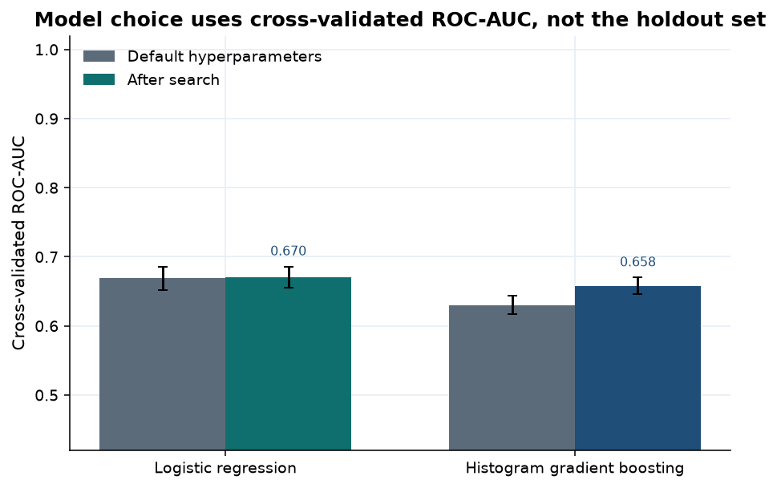

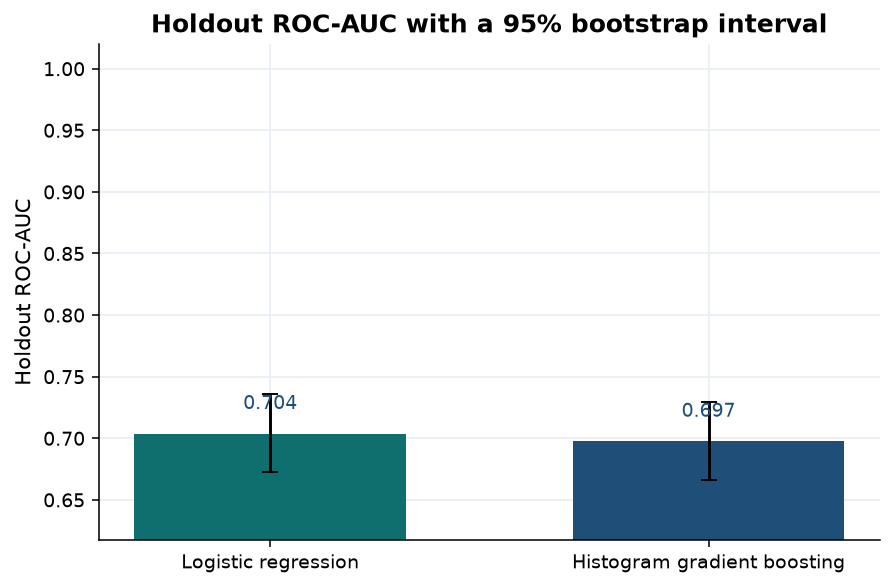

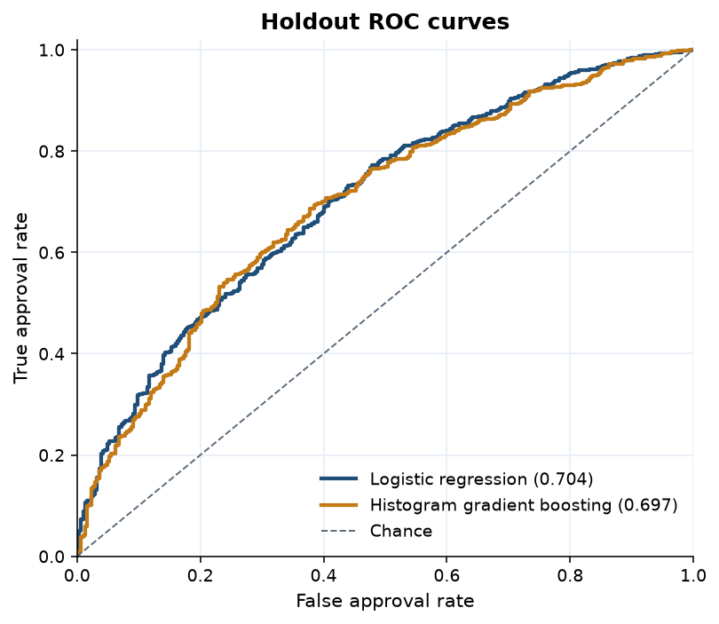

### The deployed policy, after calibration

Isotonic calibration is fit on training out-of-fold scores only. On the holdout, the Brier score moves from 0.223 before calibration to **0.124** after it. A constant guess at the holdout fully-paid rate scores 0.135. The calibrated score beats that constant. The uncalibrated score, pulled off the base rate by `class_weight="balanced"`, does not.

The calibrated holdout ROC-AUC is **0.703** (95% bootstrap interval 0.674 to 0.734). The uncalibrated ranking AUC is 0.704. Isotonic ties move the third decimal. Quote 0.703 with the interval when you quote the deployed score's ranking, and quote the cross-validated 0.670 when you explain why this model was chosen.

The cutoff on the calibrated score is **0.89**. F1 at that cutoff is 0.406. The holdout approves 437 of 1,916 loans (22.8%).

|  | Decline | Approve |
| --- | ---: | ---: |
| Not fully paid | 285 | 22 |
| Fully paid | 1,194 | 415 |

Of those 437 approvals, 415 are fully paid (precision 94.9%). The rule approves 415 of 1,609 fully paid loans (recall 25.8%) and declines 285 of 307 loans that were not fully paid (92.8%).

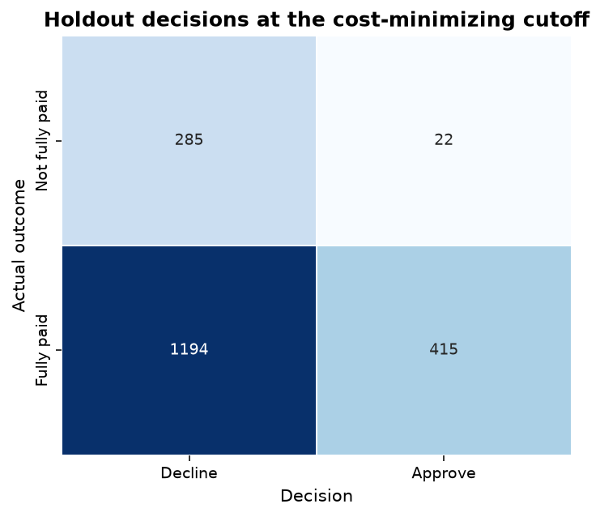

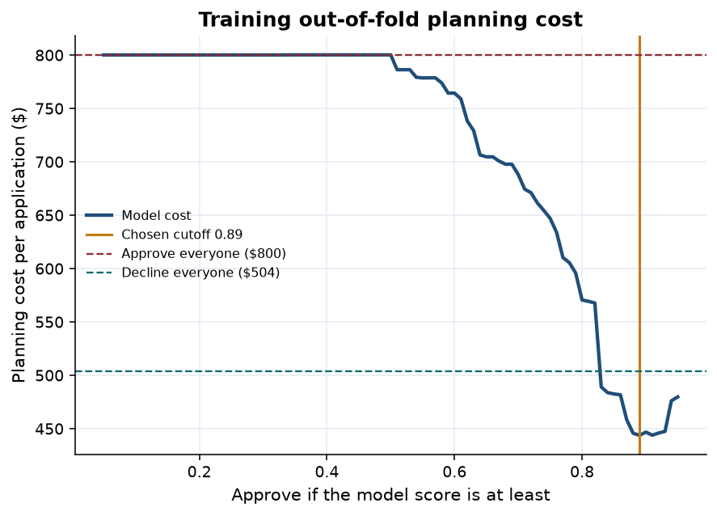

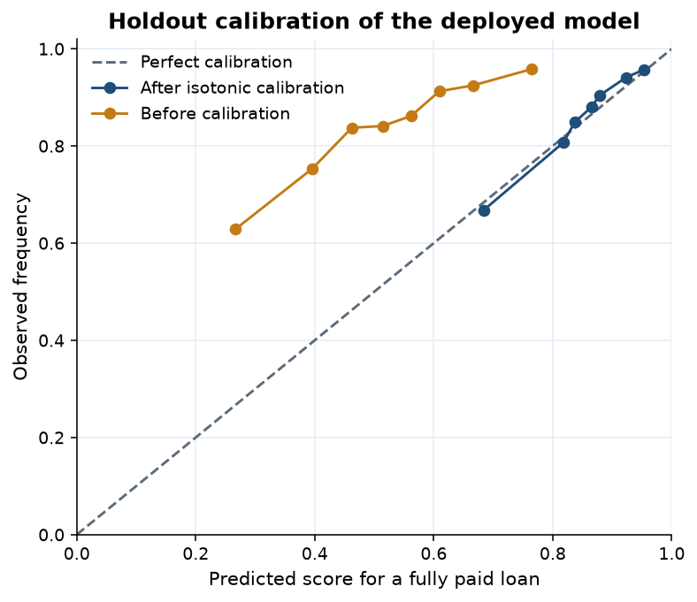

### Money on the holdout book

Same 1,916 loans, same planning weights, decisions from the calibrated score at 0.89. These totals are that book only. They are not annualized and they are not recoveries.

| Rule | Planning cost | Versus the scored cutoff |
| --- | ---: | ---: |
| Approve everyone | $1,535,000.00 | scored cutoff costs $708,600.00 less |
| Decline everyone | $965,400.00 | scored cutoff costs $139,000.00 less |
| **Scored cutoff (0.89)** | **$826,400.00** | **$431.32 per loan** |

Decline-everyone is the cheaper rule that ignores the model ($503.86 per loan). The scored cutoff saves **$72.55 per loan** against it, **$139,000.00** on this holdout. The arithmetic is the 415 good approvals the rule is willing to book, minus the 22 loans it funds that are not fully paid: 415 × $600 − 22 × $5,000 = $139,000.

The portfolio tab separates this realized arithmetic from the expected one. Expected profit versus declining every loan, for each approved loan, is `p × $600 − (1 − p) × $5,000`, using the calibrated probability. Expected defaults are the sum of `1 − p` on the approvals. Those quantities do not use the labels. The realized counts do.

### What pushed the score

On the holdout, shuffling FICO drops ROC-AUC by about 0.078. Inquiries in the last six months, annual income, loan purpose, and the monthly payment are the next fields. Revolving balance is smaller. Debt-to-income, length of credit history, recent delinquencies, and public records do not move holdout AUC once the other fields are present. Public records are rare in this extract, so a near-zero shuffle cost is a thin sample, not a finding that public records never matter.

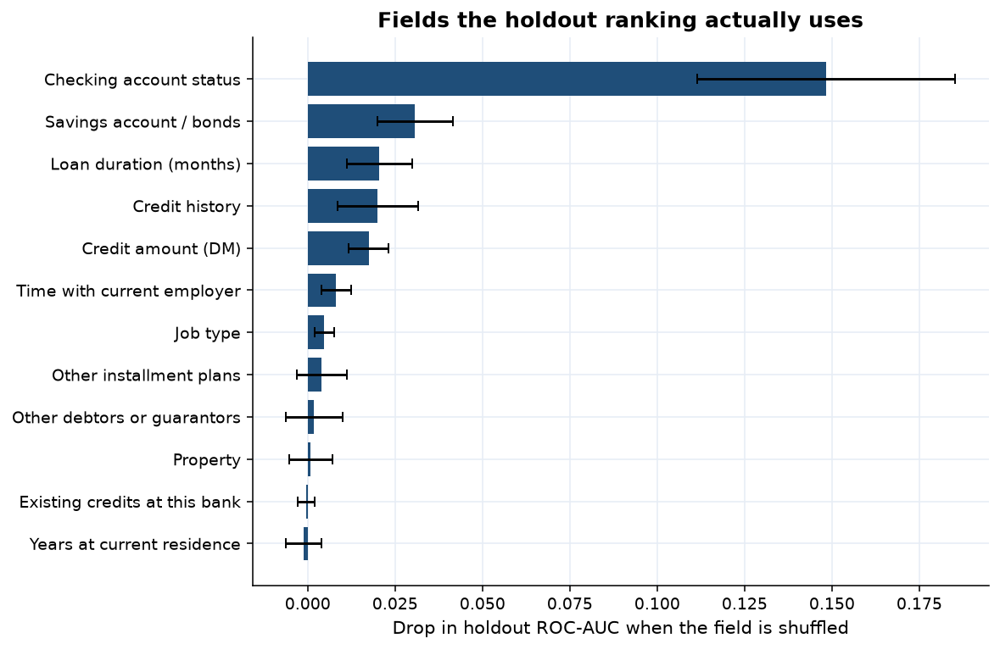

Dropping FICO and refitting, at the same logistic hyperparameters, lowers cross-validated ROC-AUC by about 0.012 (0.670 to 0.658). That is inside a fold standard deviation of 0.015. The shuffle hurts more than the refit because the refit can lean on income, inquiries, and purpose, which move with FICO. Putting `credit_policy` and `int_rate` back changes cross-validated ROC-AUC by about +0.001. The old policy flag and the platform's price do not buy ranking accuracy on top of the application fields.

The logistic coefficients are the deployed ranking model, on standardized inputs, before the isotonic map. A small-business purpose lowers the log-odds of a fully paid loan the most. A credit-card payoff, a higher FICO, a major-purchase purpose, and higher income raise them. More inquiries, a larger monthly payment, and a higher revolving balance lower them.

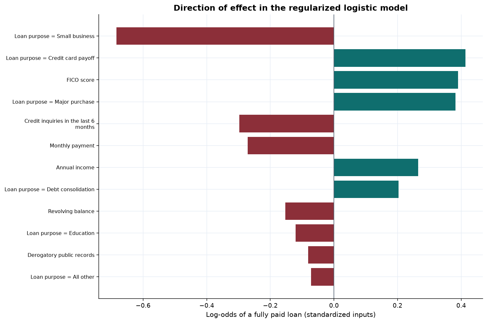

### Where the approvals land

Rates below use out-of-fold training scores from the deployed model, at the deployed cutoff of 0.89. The four-fifths ratio is a screening arithmetic. It is not a legal conclusion. This extract has no sex, age, or race, and the reference groups are "meets the old credit policy," FICO 760 and over, and debt consolidation.

| Group | n | Fully paid | Approval rate | True approval rate | Ratio vs reference |
| --- | ---: | ---: | ---: | ---: | ---: |
| Meets old policy | 6,199 | 86.6% | 30.5% | 33.0% | 1.00 |
| Outside old policy | 1,463 | 72.8% | 2.9% | 3.8% | 0.10 |
| FICO under 680 | 1,735 | 77.2% | 1.4% | 1.9% | 0.02 |
| FICO 680–719 | 3,007 | 82.8% | 8.5% | 9.2% | 0.10 |
| FICO 720–759 | 1,974 | 87.2% | 43.8% | 46.6% | 0.52 |
| FICO 760 and over | 946 | 93.3% | 83.5% | 85.5% | 1.00 |
| Debt consolidation | 3,151 | 84.4% | 20.0% | 21.6% | 1.00 |
| Credit card payoff | 1,028 | 88.1% | 42.6% | 46.2% | 2.13 |
| All other | 1,878 | 83.7% | 24.5% | 28.0% | 1.23 |
| Home improvement | 498 | 84.3% | 31.3% | 34.0% | 1.57 |
| Major purchase | 338 | 89.6% | 58.3% | 60.7% | 2.92 |
| Education | 267 | 80.9% | 16.1% | 18.5% | 0.81 |
| Small business | 502 | 71.9% | 2.2% | 2.8% | 0.11 |

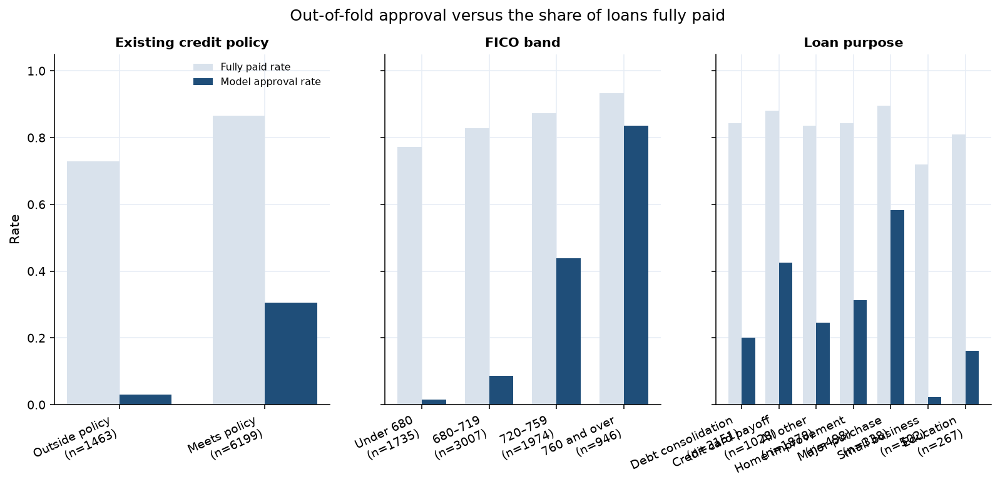

The model never sees the old policy flag, and it still approves 2.9% of outside-policy loans against 30.5% of loans that met the old policy. That gap is carried by the fields it does see, mostly FICO and inquiries. FICO is in the score on purpose, so approval rising from 1.4% under 680 to 83.5% at 760 and over is the cutoff doing what it was asked to do. The fully-paid rate also rises with FICO, from 77.2% to 93.3%, and the approval gap is much steeper than that repayment gap because the cutoff is strict.

Small business is the purpose with the lowest fully-paid rate in the training book (71.9%) and the lowest approval rate (2.2%). Credit-card payoff and major purchase are approved well above the debt-consolidation reference. Those purpose gaps are large enough to show a reviewer, and too entangled with FICO and loan size to treat as a pure purpose effect.

## Credit desk

```bash
streamlit run streamlit_app.py
```

Streamlit Community Cloud uses that same command from the repository root. The entry point is `streamlit_app.py`. Dependencies are pinned in `requirements.txt`. Python 3.12 is pinned in `runtime.txt`. Theme and browser settings are in `.streamlit/config.toml`.

The desk has four tabs.

**Score one file.** The form scores as you edit. It shows the calibrated probability, the cutoff, the margin, and a referral flag when the score sits within 5 points of the cutoff. For a decline it lists the principal reasons in plain English and a one-field counterfactual: a change, inside the training range, that the model actually scores above the cutoff. The slider changes risk appetite. The score stays put. Interest rate and the old credit-policy flag are not on the form.

**Portfolio simulator.** A second slider walks the 1,916 holdout loans. KPI cards show approvals, expected defaults, expected profit versus declining everyone, and realized defaults. The chart draws expected profit and realized savings across cutoffs. The two series are labeled differently because one uses probabilities and the other uses labels.

**Batch scoring.** Download a template or upload a CSV. The file comes back with a probability, a decision, up to three decline reasons, and a counterfactual hint.

**Fairness and limits.** The out-of-fold segment table, the groups outside a 0.80–1.25 ratio versus their reference, and the limits written into `MODEL_CARD.md`.

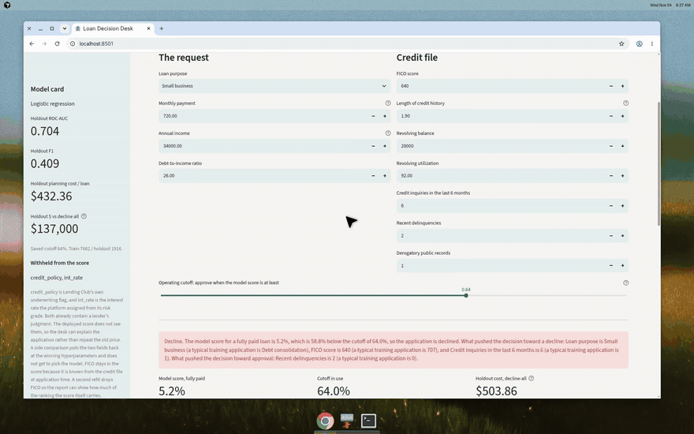

Example presets cover a typical training profile, a stronger file, and a higher-risk file.

## How to run

Python 3.11 or newer. Development here used 3.12.

```bash
python -m venv .venv
source .venv/bin/activate
pip install -r requirements-dev.txt

PYTHONPATH=src python -m loan_approval.train
PYTHONPATH=src python -m loan_approval.train --download   # refresh the OpenML cache

pytest
ruff check .
ruff format --check .
streamlit run streamlit_app.py
```

`pytest` reads `pythonpath = ["src"]` from `pyproject.toml` and fails if coverage of `loan_approval` drops under 95%. GitHub Actions (`.github/workflows/ci.yml`) runs Ruff and pytest on Python 3.12 using the cached CSV. It does not retrain and it does not call OpenML.

Saved artifacts: `models/credit_pipeline.joblib` and `models/model_card.json`. `MODEL_CARD.md` is rendered from that JSON. They were fit with scikit-learn 1.9.1. Retrain after an upgrade.

## Layout

```
streamlit_app.py      Community Cloud entry point, repo root
app/streamlit_app.py  loan desk: score, simulator, batch, fairness
.streamlit/config.toml
runtime.txt           Python 3.12 for Community Cloud
requirements.txt      pinned runtime dependencies
src/loan_approval/    data, search, bootstrap, calibration, portfolio, reasons
MODEL_CARD.md         model card rendered from models/model_card.json
data/lending_club_sample.csv
models/               fitted pipeline, isotonic map, and model card
reports/figures/      charts in this readme
docs/demo.gif         short desk recording
tests/                pytest suite
```

## Business findings

1. Under the stated weights, the scored cutoff earns its keep on loans it did not see. Holdout planning cost is $826,400.00, against $965,400.00 for declining everyone and $1,535,000.00 for approving everyone. That is $139,000.00 saved versus the better naive rule, $72.55 a loan, by approving 22.8% of the holdout and keeping 94.9% of those approvals fully paid.
2. F1 of 0.406 is what a strict cutoff looks like when most fully paid loans are turned away on purpose. Cost, the false-approval count (22 of 307), and ROC-AUC are the figures that match the decision.
3. Logistic regression wins the pre-specified comparison. Its cross-validated ROC-AUC is 0.670 ± 0.015 against 0.658 ± 0.012 for histogram gradient boosting, and the out-of-fold bootstrap interval for the gap excludes zero (0.003 to 0.021). The holdout interval for the same gap includes zero (-0.010 to 0.022). That holdout interval is reported and was not allowed to pick the model.
4. Calibrate before you talk about a probability. Balanced class weights put the raw Brier score at 0.223, worse than guessing the holdout base rate (0.135). After the isotonic map the Brier score is 0.124, and the cost cutoff lands at 0.89, next to the 0.893 break-even of the two weights.
5. FICO is the field worth getting right, then recent inquiries, income, purpose, and the monthly payment. Debt-to-income adds nothing measurable once those are in the score. The old credit-policy flag and the platform's interest rate add about 0.001 of cross-validated AUC. They are not worth feeding back into a new screen.
6. The cutoff concentrates approvals in high FICO, credit-card payoff, and major purchase, and it almost never approves a small-business purpose or a file the old policy would have failed. That is the score and the $5,000 / $600 weights, not a protected-class result. This extract cannot support a sex, age, or race audit.
7. Send files within 5 points of the cutoff to an analyst. The plain-English reasons and the one-field hint are review notes. They are not a FCRA adverse-action letter, and the hint is not an instruction to change a credit file.
8. Quote expected defaults from the probabilities and realized defaults from the labels as two different numbers. The simulator shows both so a planning figure is not mistaken for what this holdout book did.

## Limitations

The book is a 9,578-loan public extract, not a lender's through-the-door population, and there is no reject inference. Labels are "fully paid" versus "not fully paid," which is broader than a charge-off. The file has no term, no principal, and no loss amount, so the $5,000 and $600 weights are a scenario tied to a 36-month sketch at the sample means. The monthly payment still carries some of the offer, because installment depends on amount, rate, and term, even though the rate itself is withheld. Explanations are one-field ablations of the ranking score, and the counterfactual is the smallest one-field change inside the training range that the calibrated probability scores above the cutoff. The isotonic map is flat in places, so a decline can have clear ranking reasons and still have no single-field change that clears the cutoff. Correlated inputs share credit. A small swap can point the surprising way. Treat a move of a point or two as noise. The isotonic map was fit on out-of-fold training scores; it is not a promise that a future book will match these frequencies. The holdout gap between the two models has a bootstrap interval that includes zero, so a claim that logistic regression is more accurate on new loans, beyond this split, is stronger than the holdout evidence. Segment rates for education, major purchase, and outside-policy loans are smaller slices. The saved pipeline is tied to the scikit-learn version in `requirements.txt`.

## License

Code is released under the MIT license. The cached extract is used under the CC0 licence recorded by OpenML for data id 43729. Cite that OpenML record when you reuse the file.
